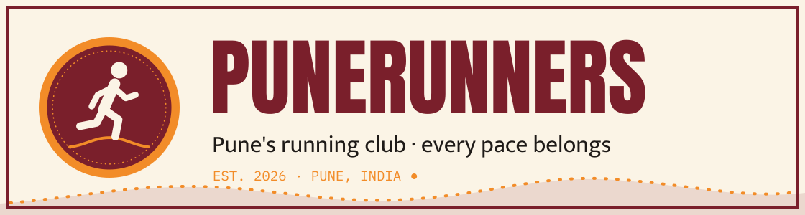

# PuneRunners

Pune's running club. No headphones. No one runs alone.

**[punerunners.com](https://punerunners.com)** · [r/punerunners](https://www.reddit.com/r/punerunners/) · [WhatsApp community](https://chat.whatsapp.com/CpxvrCT4LAyDNzIqizY6Vo) · [WhatsApp channel](https://whatsapp.com/channel/0029VbDwvvO8qIzylI1Siw3i)

PuneRunners is a running club from Pune, India. It started in January 2026 out of the PuneTrekkers community.

- **Website** - race calendars, certification-checked race listings, routes and club news: [punerunners.com](https://punerunners.com)
- **WhatsApp community** - the day-to-day chat, run coordination and race plans: [join the group](https://chat.whatsapp.com/CpxvrCT4LAyDNzIqizY6Vo)
- **WhatsApp channel** - one-way updates: race calendars and club news: [follow the channel](https://whatsapp.com/channel/0029VbDwvvO8qIzylI1Siw3i)
- **Reddit** - posts, questions and finding a buddy: [r/punerunners](https://www.reddit.com/r/punerunners/)

Sister communities: [PuneTrekkers](https://punetrekkers.org) and [Karawaan](https://karawaan.in).
